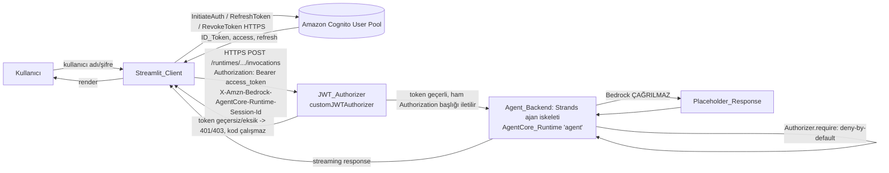
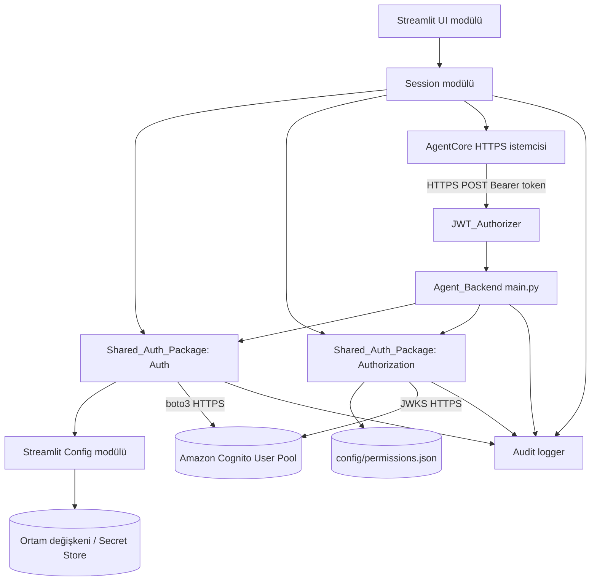
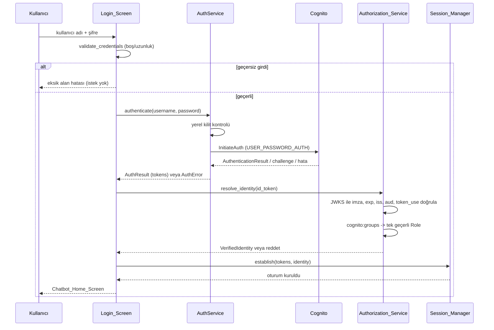
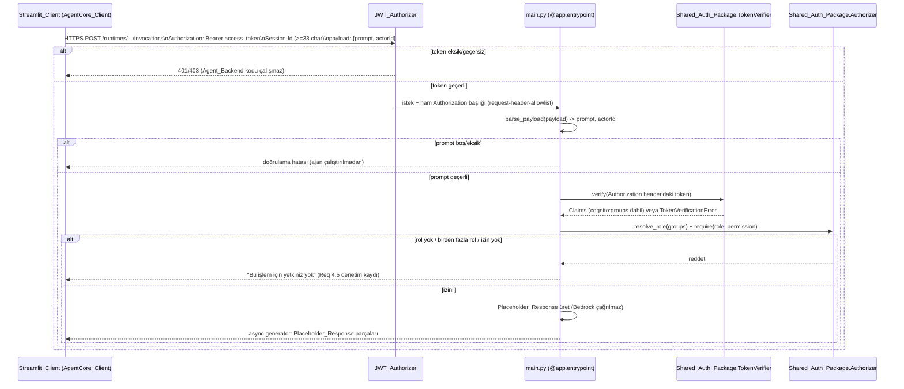
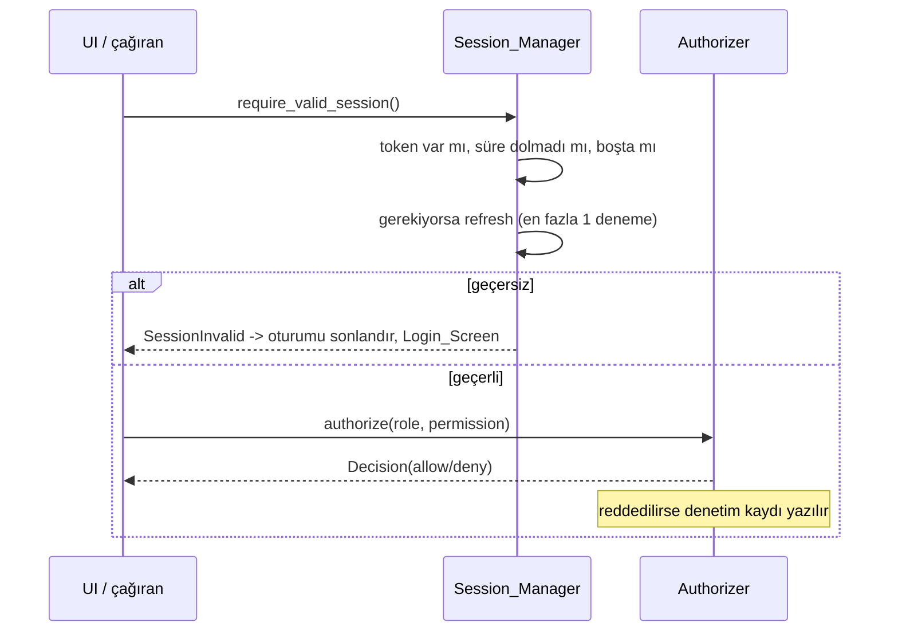

# Design Document

## Overview

Bu doküman, `logistics-ai-auth` özelliğinin (Logistics AI Assistant, Faz 1: Kullanıcı Kimlik Doğrulama ve Yetkilendirme) teknik tasarımını tanımlar. Gereksinimler `requirements.md` dosyasındadır. Proje `/home/participant/environment/Logistic_AI` klasöründe oluşturulacaktır. Aynı çalışma alanındaki `CustomerServiceAgent` projesi bu özellikle ilgili değildir ve kapsam dışıdır.

Bu revizyon, `requirements.md`'ye eklenen Requirement 11-14 (AgentCore CLI proje iskeleti, Strands ajan iskeleti ve yer tutucu yanıt, AgentCore dağıtımı ve Cognito JWT korumalı erişim, README belgesi) ile değiştirilen 3.7, 4.7 ve 9.7-9.9 gereksinimlerini yansıtır. Önceki tasarımda tek bir Streamlit uygulaması varsayılıyordu; bu revizyonda dağıtım mimarisi iki parçaya ayrılır: AgentCore_Runtime üzerinde çalışamayan **Streamlit_Client** ve AgentCore_Runtime'da `agent` adıyla barındırılan **Agent_Backend** (Strands ajan iskeleti).

### Hedefler

- Python ve Streamlit ile giriş ekranı, chatbot ana ekranı iskeleti ve çıkış akışı (Streamlit_Client).
- Amazon Cognito (boto3, `USER_PASSWORD_AUTH`, istemci sırrı olmayan app client) ile kimlik doğrulama.
- ID_Token'ın JWKS ile doğrulanması ve rolün yalnızca doğrulanmış token'daki `cognito:groups` talebinden türetilmesi; bu kural hem Streamlit_Client hem de Agent_Backend için geçerlidir.
- Merkezi, yapılandırma ile değiştirilebilir izin tablosu ve backend tarafında (Agent_Backend içinde) rol bazlı yetkilendirme (varsayılan olarak reddet); Streamlit_Client tarafındaki kontroller yalnızca ek kullanıcı deneyimidir ve yerine geçmez (Req 4.7).
- Sunucu tarafı oturum yönetimi, token yenileme, boşta kalma zaman aşımı ve çıkış.
- Sırların yalnızca ortam değişkeni veya yönetilen sır deposundan okunması.
- Denetim günlüğü ve genel hata mesajları.
- Beş ayrı modül: UI, auth, authorization, session, config (Streamlit_Client içinde); bu modüllerin auth ve authorization mantığı `Shared_Auth_Package` olarak Agent_Backend ile paylaşılır (Req 9.8).
- Agent_Backend'in AgentCore CLI (`agentcore create --name LogisticAI --template agent-python-strands`) ile iskeletlenmesi, `customJWTAuthorizer` ile korunması ve Bedrock modeli çağırmadan deterministik bir `Placeholder_Response` döndüren bir Strands ajan iskeleti olması (Req 11, 12, 13).

### Kapsam Dışı

Amazon Bedrock model çağrıları, gerçek ajan davranışı, Skills, Tools uygulaması ve MCP entegrasyonları Faz 1'de yoktur (Requirement 9.7); Requirement 12'de tanımlanan Strands ajan iskeleti (boş/stub genişletme noktaları ve yer tutucu yanıt) bu kısıttan hariçtir. AgentCore Memory kaynağı (`agentMemory`) Faz 1'de oluşturulmaz veya etkinleştirilmez; şablonun getirdiği tanım `agentcore.json`'dan kaldırılır (Req 12.5). Gelecekteki yapay zekâ bileşenleri için yalnızca tek bir kullanıcı bağlamı arayüzü (`UserContextProvider`) sunulur (Requirement 9.5, 9.6).

### Açık Sorular

1. **Her rol için somut izin (Permission) listeleri henüz tanımlı değildir.** Faz 1, yalnızca izin tablosunun yapısını, yükleme/doğrulama mantığını ve değerlendirme motorunu teslim eder. `SUPPLIER`, `MATERIAL_RESPONSIBLE` ve `TRANSPORT_OFFICE` rollerine hangi izinlerin verileceği iş tarafından belirlenmelidir. Bu belirlenene kadar varsayılan izin tablosu tüm roller için boş izin kümesi içerir ve deny-by-default kuralı nedeniyle tüm korumalı işlemler reddedilir. Tablo, kod değişikliği olmadan doldurulabilir (Requirement 4.1, 9.3). İzinler netleştiğinde `requirements.md` ve bu doküman güncellenmelidir.

2. **Doğrulanmış JWT taleplerinin Agent_Backend işleyicisine ulaşma yöntemi, AgentCore'un güncel davranışına karşı dağıtım sırasında doğrulanmalıdır.** Bu tasarım, aşağıdaki "Agent_Backend: Rolün Türetilmesi" bölümünde açıklanan yaklaşımı (ham `Authorization` başlığını `request-header-allowlist` ile işleyiciye iletme ve `Shared_Auth_Package.TokenVerifier` ile yeniden doğrulama) seçer; ancak AgentCore dokümantasyonu `context.request_headers` özelliğinin yalnızca `Authorization` ve `X-Amzn-Bedrock-AgentCore-Runtime-Custom-` ön ekli başlıkları içerdiğini belirtir ve bu davranış sürüm güncellemeleriyle değişebilir. Görev uygulama aşamasında, kullanılan `bedrock-agentcore` SDK sürümünün güncel örnekleriyle (`agentcore create` çıktısı, resmi dokümantasyon) doğrulanmalı; işaretlenen bu madde kapatılmalıdır.

### Araştırma Özeti ve Tasarım Kararları

Araştırma, AWS ve kütüphane dokümantasyonuna ve yerleşik bilgiye dayanır; ayrı bir araştırma dosyası oluşturulmamıştır.

| Konu | Bulgu | Karar |
|---|---|---|
| Cognito akışı | `InitiateAuth` ile `USER_PASSWORD_AUTH` akışı, istemci sırrı olmayan app client ile çalışır. App client'ta bu akışın açıkça etkinleştirilmesi gerekir. Yanıt `AuthenticationResult` (IdToken, AccessToken, RefreshToken) veya `ChallengeName` içerir. | `boto3` `cognito-idp` istemcisi kullanılır. `NEW_PASSWORD_REQUIRED` challenge'ı token vermeden reddedilir (Req 2.6). |
| Token yenileme | `InitiateAuth` ile `REFRESH_TOKEN_AUTH` akışı yeni ID ve access token döndürür. | Yenileme `AuthService.refresh` içinde yapılır (Req 6.3). |
| Token iptali | Cognito `RevokeToken` API'si refresh token'ı iptal eder. App client'ta token revocation etkin olmalıdır. | Çıkışta `RevokeToken` çağrılır (Req 7.3). |
| JWT doğrulama | Cognito, `https://cognito-idp.{region}.amazonaws.com/{poolId}/.well-known/jwks.json` adresinde JWKS yayınlar. ID token `RS256` ile imzalanır, `aud` değeri app client ID'dir, `iss` değeri havuz URL'sidir, grup bilgisi `cognito:groups` talebindedir. | `PyJWT` (`PyJWKClient`) ile imza, `exp`, `iss`, `aud` ve `token_use == "id"` doğrulanır. |
| Brute-force | Cognito, art arda başarısız denemelerden sonra geçici kilitleme uygular ve `NotAuthorizedException` döndürür. | Cognito yanıtı genel mesaja çevrilir. Uygulama ayrıca bellek içi bir sayaçla yerel kilitleme uygular (Req 2.7). |
| Streamlit oturumu | `st.session_state` sunucu tarafında tutulur ve tarayıcıya token yazmaz. Yeni bir tarayıcı oturumu boş durumla başlar. | Tüm token'lar yalnızca `st.session_state` içinde tutulur (Req 6.1, 6.2). |
| TLS | boto3 varsayılan olarak HTTPS kullanır. | `endpoint_url` yalnızca `https://` olabilir. Çalışma ortamında TLS 1.2+ zorlanır (Req 8.7, 8.8). |
| Test kütüphanesi | Python için Hypothesis olgun bir property-based test kütüphanesidir. | Hypothesis + pytest kullanılır. |
| AgentCore Runtime çağırma URL'si | `InvokeAgentRuntime` API'si `https://bedrock-agentcore.{region}.amazonaws.com/runtimes/{url-encoded-agent-arn}/invocations?qualifier=DEFAULT` adresine `Authorization: Bearer {token}` başlığıyla HTTPS POST yapılarak çağrılabilir; oturum kimliği `X-Amzn-Bedrock-AgentCore-Runtime-Session-Id` başlığında gönderilir ve en az 33 karakter olmalıdır. | Streamlit_Client, `boto3` SigV4 istemcisi yerine doğrudan HTTPS POST + Bearer token kullanır (JWT inbound auth, SigV4 ile birlikte kullanılamaz). |
| AgentCore inbound JWT yetkilendirme | Runtime, `customJWTAuthorizer` ile `discoveryUrl` (Cognito OIDC discovery URL'si) ve `allowedClients`/`allowedAudience` alanlarını kabul eder; bir Runtime aynı anda hem SigV4 hem JWT inbound auth kullanamaz. Jetonun geçersiz veya eksik olduğu istekler Agent_Backend kodu çalışmadan reddedilir. | `agentcore.json`'da `authorizerType: CUSTOM_JWT` ve `customJwtAuthorizer: {discoveryUrl, allowedClients}` tanımlanır (Req 13.3, 13.4). |
| Agent_Backend'e talep (claims) iletimi | AgentCore, `Authorization` başlığını yalnızca runtime `customJWTAuthorizer` ile yapılandırılmışsa ve `request-header-allowlist`'e eklenmişse işleyiciye iletir; işleyicideki `context.request_headers`, sadece `Authorization` ve `X-Amzn-Bedrock-AgentCore-Runtime-Custom-` ön ekli başlıkları içerir. AgentCore, kendisi talepleri ayrıştırıp payload'a enjekte etmez; ham token işleyiciye ulaşır. | Agent_Backend, `context.request.headers["Authorization"]`'dan ham Bearer token'ı okur ve `Shared_Auth_Package.TokenVerifier` ile (Streamlit_Client'ın kullandığı aynı doğrulama mantığı) yeniden doğrular; rolü yalnızca bu doğrulanmış taleplerden türetir (bkz. Açık Soru 2 ve "Agent_Backend: Rolün Türetilmesi"). |
| AgentCore proje iskeleti | `agentcore create --name X --template agent-python-strands`, `app/agent/` altında `main.py`, `parse.py`, `model/load.py`, `memory/session.py`, `pyproject.toml`, `tests/` dosyalarını ve `agentcore/agentcore.json` içinde `agent` adlı runtime ile `agentMemory` adlı bir AgentCore Memory tanımını oluşturur. | Şablon komutuyla oluşturulur; `agentMemory` tanımı Faz 1 kapsamı dışı olduğundan kaldırılır (Req 12.5). `prompts/system_prompt.py` ve `tools/` elle eklenir. |
| ARM64 ve bağımlılık yönetimi | AgentCore Runtime Graviton (ARM64) üzerinde çalışır; `pyproject.toml`'daki `[project].dependencies` yalnızca çalışma zamanı paketlerini içermeli, `pytest`/`hypothesis` gibi test araçları `[dependency-groups].dev`'e konmalıdır çünkü CodeZip derlemesi `uv export --no-default-groups` ile dev gruplarını hariç tutar. | Shared_Auth_Package dahil tüm çalışma zamanı bağımlılıkları ARM64 Linux wheel'i olan paketlerle sınırlandırılır (`boto3`, `PyJWT[crypto]` içindeki `cryptography` ARM64 wheel sağlar). |

Kaynaklar: [Amazon Cognito InitiateAuth API](https://docs.aws.amazon.com/cognito-user-identity-pools/latest/APIReference/API_InitiateAuth.html), [Cognito ID token doğrulama](https://docs.aws.amazon.com/cognito/latest/developerguide/amazon-cognito-user-pools-using-tokens-verifying-a-jwt.html), [Cognito RevokeToken](https://docs.aws.amazon.com/cognito-user-identity-pools/latest/APIReference/API_RevokeToken.html), [AgentCore Runtime'a özel başlık geçirme](https://docs.aws.amazon.com/bedrock-agentcore/latest/devguide/runtime-header-allowlist.md), [AgentCore Inbound/Outbound Auth (OAuth/JWT)](https://docs.aws.amazon.com/bedrock-agentcore/latest/devguide/runtime-oauth.md), [AgentCore Inbound JWT Authorization](https://docs.aws.amazon.com/bedrock-agentcore/latest/devguide/inbound-jwt-authorizer.md), [AgentCore Invoke an agent](https://docs.aws.amazon.com/bedrock-agentcore/latest/devguide/runtime-invoke-agent.md). İçerik lisans kısıtları nedeniyle özetlenerek aktarılmıştır.

## Architecture

### Dağıtım Topolojisi

Streamlit arayüzü AgentCore_Runtime üzerinde çalışamadığından uygulama iki ayrı dağıtılabilir parçadan oluşur: **Streamlit_Client** (yerel veya konteyner; barındırma hedefi zorunlu kılınmaz, Req 13.12) ve **Agent_Backend** (AgentCore_Runtime'da `agent` adıyla barındırılan Strands ajan iskeleti). İkisi arasındaki tek bağlantı HTTPS üzerinden, kullanıcının Cognito token'ını taşıyan bir `Authorization: Bearer` isteğidir; `AgentCore_Runtime`'ın önündeki `JWT_Authorizer`, Agent_Backend kodu hiç çalışmadan geçersiz veya eksik token'ları reddeder (Req 13.3, 13.4).



Not: `AG -->|Bedrock ÇAĞRILMAZ|` kenarı, Faz 1'de Agent_Backend'in Amazon Bedrock modelini hiç çağırmadığını, yalnızca sabit bir `Placeholder_Response` ürettiğini vurgular (Req 12.2).

### Katmanlar ve Modüller

Beş modül vardır. Modüller yalnızca birbirlerinin genel (public) arayüzlerini kullanır; alt çizgi ile başlayan iç öğelere erişilmez (Req 9.1).

| Modül | Paket | Sorumluluk |
|---|---|---|
| UI | `streamlit_client/logistic_ai/ui` | Streamlit ekranları (Login_Screen, Chatbot_Home_Screen), yönlendirme |
| Auth | `logistic_ai_shared_auth/auth` (Shared_Auth_Package) | `AuthService` arayüzü, Cognito ve mock uygulamaları, hata eşleme, yerel kilitleme |
| Authorization | `logistic_ai_shared_auth/authorization` (Shared_Auth_Package) | Token doğrulama, rol çözümleme, izin tablosu, yetki kararı, yetki denetim kaydı |
| Session | `streamlit_client/logistic_ai/session` | Oturum durumu, token yenileme, geçerlilik, boşta kalma, çıkış, `UserContextProvider`, AgentCore HTTPS istemcisi |
| Config | `streamlit_client/logistic_ai/config` | Sır deposu okuma, doğrulama, boşta kalma süresi ayrıştırma, izin tablosu dosya yolu |

Ortak yardımcılar (`audit`, `log sanitizer`) `logistic_ai_shared_auth/common` altında yer alır ve Auth/Authorization tarafından paylaşılır; UI'a özgü günlük maskeleme Streamlit_Client içinde kalır. Auth ve Authorization modülleri Shared_Auth_Package'a taşındığı için hem Streamlit_Client hem de Agent_Backend tarafından aynı kod olarak içe aktarılır (Req 9.8); Agent_Backend'in kendi `authorizer.py` çağrısı yoktur, Shared_Auth_Package'ı doğrudan kullanır. Bağımlılık yönü tek yönlüdür: Streamlit UI → Session → (Auth, Authorization via Shared_Auth_Package); Agent_Backend `main.py` → (Auth, Authorization via Shared_Auth_Package) → Config benzeri yerel ayarlar. Authorization ve Auth birbirine bağımlı değildir; birleştirme işi, Streamlit tarafında Session/UI katmanında, Agent_Backend tarafında `main.py`/handler katmanındadır.



### Proje Yapısı

`Logistic_AI/` klasörü, Agent_Backend iskeletini AgentCore_CLI ile oluşturduktan sonra Streamlit_Client kodunun eklendiği tek bir git deposudur. `agentcore create --name LogisticAI --template agent-python-strands` komutu `agentcore/` ve `app/agent/` alt ağaçlarını üretir; bu dosyalar elle oluşturulmaz (Req 11.1). Streamlit_Client ve `config/permissions.json` bu komutun ürettiği yapıya elle eklenir.

```
Logistic_AI/
├── agentcore/
│   └── agentcore.json          # runtime "agent": envVars (UNIFIED_TRACES_DESTINATION_ENABLED=true),
│                                #   customJWTAuthorizer (discoveryUrl + allowedClients), additionalPolicies;
│                                #   agentMemory tanımı kaldırılmış (Req 12.5)
├── streamlit_client/
│   ├── app.py                  # Streamlit giriş noktası
│   ├── pyproject.toml          # Bağımlılıklar: streamlit, requests, PyJWT[crypto];
│   │                           #   logistic_ai_shared_auth = {path="../app/agent/logistic_ai_shared_auth", editable=true}
│   ├── logistic_ai/
│   │   ├── config/             # settings.py
│   │   ├── auth/                # cognito_service.py, mock_service.py  (AuthService ABC artık Shared_Auth_Package'da)
│   │   ├── session/            # manager.py, user_context.py, agentcore_client.py (HTTPS invoke istemcisi)
│   │   ├── ui/                  # login_screen.py, home_screen.py, router.py
│   │   └── common/              # log_sanitizer.py (UI'a özel)
│   └── tests/
├── config/
│   └── permissions.json        # Merkezi izin tablosu (sır değildir, sürüm kontrolünde); Agent_Backend tarafından okunur
├── app/
│   └── agent/                  # AgentCore_CLI tarafından oluşturulan runtime kod dizini (CodeZip build kökü)
│       ├── main.py              # @app.entrypoint async generator, lazy agent init (Req 11.8, 11.9)
│       ├── parse.py             # parse_payload: prompt, actorId (Req 11.10)
│       ├── model/load.py        # Faz 1'de işlevsiz stub (Req 12.4, 12.6)
│       ├── memory/session.py    # Faz 1'de işlevsiz stub; agentMemory kullanılmaz (Req 12.4, 12.5)
│       ├── prompts/system_prompt.py  # Faz 1'de işlevsiz stub (Req 12.4)
│       ├── tools/                # Faz 1'de boş paket (Req 12.4)
│       ├── logistic_ai_shared_auth/  # Shared_Auth_Package (vendored) — bkz. aşağıdaki karar
│       │   ├── __init__.py
│       │   ├── auth/            # service.py (AuthService ABC), cognito_service.py, mock_service.py, errors.py, lockout.py
│       │   ├── authorization/   # token_verifier.py, roles.py, permission_table.py, authorizer.py
│       │   └── common/          # audit.py, log_sanitizer.py, errors.py
│       ├── pyproject.toml       # [project].dependencies: yalnızca çalışma zamanı paketleri (ARM64 wheel'li);
│       │                       #   [dependency-groups].dev: pytest, hypothesis (Req 11.5, 9.9)
│       └── tests/
└── README.md                   # Türkçe (Req 14)
```

#### Shared_Auth_Package konumlandırma kararı

Auth_Service ve Authorization_Service mantığının Streamlit_Client ve Agent_Backend tarafından aynı kod olarak kullanılması gerekir (Req 9.8). İki seçenek değerlendirildi:

| Seçenek | Açıklama | Değerlendirme |
|---|---|---|
| A. Bağımsız üçüncü paket (PyPI/özel index veya git bağımlılığı) | `logistic_ai_shared_auth` ayrı bir depo/paket olarak yayınlanır, her iki taraf sürüm numarasıyla bağımlı olur. | Temiz sürümleme sağlar, ancak AgentCore CodeZip derlemesi yalnızca `app/agent/` dizinini paketler; dış index erişimi olmayan bir derleme ortamında ek bir private-index kurulumu gerektirir. Faz 1 kapsamında gereksiz operasyonel yük. |
| B. `app/agent/` altına vendored paket + Streamlit_Client'tan `uv` yol (path) bağımlılığı (**seçildi**) | Paket, CodeZip'in zaten içerdiği `app/agent/logistic_ai_shared_auth/` altında yaşar. Agent_Backend onu doğrudan yerel modül olarak içe aktarır. Streamlit_Client'ın `pyproject.toml`'u aynı pakete `path = "../app/agent/logistic_ai_shared_auth", editable = true` ile bağımlı olur (`uv add --editable`). | Tek depo, tek kaynak kod kopyası; CodeZip derlemesine ekstra adım gerekmez (Req 11.5 ile tutarlı: yalnızca çalışma zamanı bağımlılıkları `[project].dependencies`'te). Dezavantaj: paket fiziksel olarak Agent_Backend'in alt dizinindedir, bu nedenle Streamlit_Client'ın bağımsız dağıtımı (örn. ayrı bir konteynerde) `app/agent/logistic_ai_shared_auth/` alt ağacının o imaja da kopyalanmasını gerektirir; bu, konteyner Dockerfile'ında belgelenir. |

**Karar:** Seçenek B. Gerekçe: Faz 1'in önceliği operasyonel basitlik ve AgentCore CLI'nin varsayılan CodeZip akışıyla uyumluluktur; sürüm bağımsızlığı henüz gerekli değildir (tek depo, tek sürüm). Shared_Auth_Package'ın tüm bağımlılıkları (`PyJWT[crypto]`, `boto3`) ARM64 Linux wheel'i olan paketlerle sınırlıdır (Req 9.9, 11.6).

### Ana Akışlar

#### Giriş



Hiçbir token, rol çözümlemesi başarılı olmadan `Session_Manager`'a iletilmez. Rol çözümlenemezse oturum oluşturulmaz (Req 3.4 - 3.6, 5.7).

#### Agent_Backend İsteği (AgentCore Runtime)



Agent_Backend, Streamlit_Client'tan bağımsız olarak kendi rol türetmesini yapar; istek yükündeki (`actorId` dahil) hiçbir alan rol kaynağı değildir (Req 13.9, 3.7).

#### Korumalı İstek



### Önemli Tasarım Kararları

1. **Rol yalnızca doğrulanmış token'dan gelir.** `Authorizer`, rolü parametre olarak almaz. Rol, `SessionManager` içinde saklanan doğrulanmış kimlikten (`VerifiedIdentity`) okunur. Her korumalı istekte ID_Token'ın `exp` değeri yeniden kontrol edilir, böylece istemci tarafından değiştirilebilir hiçbir alan rol kaynağı olmaz (Req 3.7, 4.7).
2. **Deny by default.** Bilinmeyen rol veya izin, boş rol, tablo yükleme hatası: hepsi reddetme ile sonuçlanır (Req 4.4).
3. **Saf çekirdek, ince kenar.** Doğrulama, rol çözümleme, izin kararı, süre hesapları ve kayıt oluşturma saf fonksiyonlardır. Streamlit, boto3 ve ağ işlemleri kenarda tutulur. Bu, property-based test edilebilirliği sağlar.
4. **Soyutlama ile test edilebilirlik.** `AuthService` bir `abc.ABC`'dir. `CognitoAuthService` ve `MockAuthService` aynı arayüzü uygular. Saat (`Clock`) ve JWKS anahtar sağlayıcısı da enjekte edilir (Req 9.2).
5. **Token'lar yalnızca `st.session_state` içinde.** Çerez, URL parametresi veya `localStorage` kullanılmaz (Req 6.1, 6.2).
6. **Agent_Backend rolü bağımsız olarak türetir.** Agent_Backend, Streamlit_Client'ın gönderdiği hiçbir role/role benzeri alana güvenmez; `Authorization` başlığındaki token'ı kendi `Shared_Auth_Package.TokenVerifier` kopyasıyla yeniden doğrular ve rolü yalnızca bu doğrulanmış talepten türetir (Req 3.7, 13.9). Bu, istemci tarafı yetkilendirmenin (Streamlit_Client'taki UI gizleme) sunucu tarafı kontrolün yerine asla geçmemesini sağlar (Req 4.7).
7. **AgentCore çağrısı SigV4 değil Bearer token ile yapılır.** Runtime `customJWTAuthorizer` ile yapılandırıldığında SigV4 tabanlı IAM imzalama ile JWT inbound auth aynı runtime'da birlikte kullanılamaz; bu nedenle Streamlit_Client, `boto3` SigV4 istemcisi yerine düz HTTPS POST + `Authorization: Bearer` kullanır (bkz. Components and Interfaces → AgentCore_Client).

## Components and Interfaces

### Config modülü

```python
@dataclass(frozen=True)
class Settings:
    user_pool_id: str
    app_client_id: str
    aws_region: str
    permissions_file: Path          # varsayılan: config/permissions.json
    idle_timeout_minutes: int       # 1..480, varsayılan 30
    cognito_endpoint_url: str | None  # verilirse https:// olmalı

class ConfigError(Exception):
    missing: list[str]              # yalnızca değişken adları, değerler asla

def load_settings(env: Mapping[str, str], secret_fetcher: SecretFetcher | None = None,
                  fetch_timeout_s: float = 10.0) -> Settings: ...
def parse_idle_timeout(raw: str | None) -> int: ...   # geçersizse 30
```

- Ortam değişkenleri: `LOGISTIC_AI_USER_POOL_ID`, `LOGISTIC_AI_APP_CLIENT_ID`, `LOGISTIC_AI_AWS_REGION`, isteğe bağlı `LOGISTIC_AI_IDLE_TIMEOUT_MINUTES`, `LOGISTIC_AI_PERMISSIONS_FILE`. Yerel geliştirmede `.env.local` kullanılır ve `.gitignore` ile sürüm kontrolü dışında tutulur (Req 8.3).
- Zorunlu bir değer eksik veya boşsa `ConfigError` fırlatılır. `app.py` hata mesajına yalnızca eksik değişken adlarını yazar ve sıfır olmayan çıkış koduyla sonlanır; hiçbir istek kabul edilmez (Req 8.4).
- `SecretFetcher` isteğe bağlı bir soyutlamadır (ör. AWS Secrets Manager). 10 saniyede yanıt vermezse veya hata dönerse "Secret_Store erişim hatası" mesajıyla başlatma reddedilir (Req 8.5).
- `parse_idle_timeout`: sayısal olmayan veya 1-480 dışı değerleri reddeder ve 30 döndürür (Req 6.8, 6.9).

### Auth modülü

```python
class AuthService(ABC):
    @abstractmethod
    def authenticate(self, username: str, password: str) -> AuthResult: ...
    @abstractmethod
    def refresh(self, refresh_token: str) -> TokenSet: ...
    @abstractmethod
    def revoke(self, refresh_token: str) -> None: ...

@dataclass(frozen=True)
class TokenSet:
    id_token: str
    access_token: str
    refresh_token: str | None
    expires_in: int

class AuthErrorKind(Enum):
    INVALID_INPUT, INVALID_CREDENTIALS, NEW_PASSWORD_REQUIRED, LOCKED_OUT, SERVICE_UNAVAILABLE

class AuthError(Exception):
    kind: AuthErrorKind
    user_message: str           # her tür için sabit, genel Türkçe metin
    invalid_fields: tuple[str, ...]  # yalnızca INVALID_INPUT için

def validate_credentials(username: str, password: str) -> tuple[str, ...]:
    """Geçersiz alan adlarını döndürür. Boş demektir geçerli."""
```

- `validate_credentials`: kullanıcı adı 1-64, şifre 1-128 karakter olmalı. Yalnızca boşluktan oluşan değerler boş sayılır (Req 1.3, 1.5, 2.3). `CognitoAuthService.authenticate` bu doğrulamayı Cognito çağrısından önce yapar.
- `CognitoAuthService`: `boto3.client("cognito-idp", region_name=..., config=Config(connect_timeout=..., read_timeout=..., retries={"max_attempts": 1}))`. Toplam bekleme 5 saniyeyi aşmaz (Req 2.1, 2.5). Yanıt eşleme tablosu:
  - `NotAuthorizedException`, `UserNotFoundException`, `UserNotConfirmedException`, `PasswordResetRequiredException`: `INVALID_CREDENTIALS`, "Geçersiz kullanıcı adı veya şifre". Kullanıcı bulunamadığı bilgisi sızdırılmaz (Req 2.4). App client'ta `PreventUserExistenceErrors` etkinleştirilir.
  - `TooManyRequestsException`, `LimitExceededException` ve "Password attempts exceeded" mesajı: `LOCKED_OUT`, "Çok fazla deneme, lütfen daha sonra tekrar deneyin" (Req 2.7).
  - `ChallengeName == "NEW_PASSWORD_REQUIRED"`: `NEW_PASSWORD_REQUIRED`, token iletilmez (Req 2.6).
  - `EndpointConnectionError`, `ConnectTimeoutError`, `ReadTimeoutError`, `ClientError` (diğer), beklenmeyen istisna: `SERVICE_UNAVAILABLE`, genel hizmet hatası. Teknik ayrıntı yalnızca günlüğe yazılır (Req 2.5).
- `LoginAttemptTracker` (`lockout.py`): kullanıcı adı başına ardışık başarısız deneme sayısı ve kilit bitiş zamanı. 5 ardışık başarısızlıkta kullanıcı adı kilitlenir. Kilit süresi boyunca `authenticate` Cognito'ya gitmeden `LOCKED_OUT` döndürür. Başarılı girişte sayaç sıfırlanır. Süre (varsayılan 15 dakika) enjekte edilen `Clock` ile ölçülür. Kullanıcı adı anahtarı küçük harfe çevrilmiş ve kırpılmış olarak kullanılır.
- `MockAuthService`: programlanabilir sonuçlar ve çağrı sayacı sunar. Ağ çağrısı yapmaz (Req 9.2).
- Bu modül yalnızca `https://` uç noktalarını kabul eder. `http://` verilirse bağlantı denenmeden `SERVICE_UNAVAILABLE` benzeri bir bağlantı hatası döner (Req 8.8).

### Authorization modülü

```python
class Role(str, Enum):
    SUPPLIER = "SUPPLIER"
    MATERIAL_RESPONSIBLE = "MATERIAL_RESPONSIBLE"
    TRANSPORT_OFFICE = "TRANSPORT_OFFICE"

@dataclass(frozen=True)
class VerifiedIdentity:
    username: str
    role: Role
    expires_at: int            # ID_Token exp

class TokenVerifier:
    def __init__(self, settings: Settings, key_provider: SigningKeyProvider, clock: Clock): ...
    def verify(self, id_token: str) -> Claims:   # TokenVerificationError fırlatır

def resolve_role(groups: Sequence[str] | None) -> Role:
    """RoleResolutionError(kind=NO_ROLE | MULTIPLE_ROLES) fırlatır."""

class PermissionTable:
    @classmethod
    def from_mapping(cls, data: Mapping[str, Sequence[str]]) -> "PermissionTable": ...
    @classmethod
    def load(cls, path: Path) -> "PermissionTable": ...
    def with_definition(self, role: str, permissions: Iterable[str]) -> "PermissionTable": ...
    def permissions_for(self, role: str) -> frozenset[str]: ...

class Authorizer:
    def __init__(self, table: PermissionTable, audit: AuditLogger, clock: Clock): ...
    def authorize(self, username: str, role: str | None, permission: str) -> Decision: ...
    def require(self, ctx: UserContext, permission: str) -> None:  # reddedilirse PermissionDenied
```

- `TokenVerifier.verify`: imza (JWKS, `RS256`), `exp`, `iss == https://cognito-idp.{region}.amazonaws.com/{pool_id}`, `aud == app_client_id` ve `token_use == "id"` kontrol edilir. Eksik, okunamayan veya doğrulanamayan her token `TokenVerificationError` ile reddedilir ve hiçbir rol atanmaz (Req 3.3, 3.4). Kullanıcı 2 saniye içinde Login_Screen'e yönlendirilir. JWKS anahtarları önbelleğe alınır. Bilinmeyen `kid` durumunda bir kez yenileme denenir.
- `resolve_role`: tam eşleşme (büyük/küçük harf duyarlı) ile geçerli grupları süzer. Sonuç:
  - Geçerli grup yok, `None` veya boş: `NO_ROLE`, "Hesabınıza bir rol atanmamış" (Req 3.5).
  - Birden fazla farklı geçerli rol: `MULTIPLE_ROLES`, yöneticiyle iletişim mesajı (Req 3.6).
  - Tam olarak bir farklı geçerli rol (tekrarlar ve geçersiz adlar yok sayılır): o rol (Req 3.1, 3.8).
- `resolve_identity(id_token)`: `verify` sonra `resolve_role`. Yalnızca doğrulanmış talepleri kullanır (Req 3.2, 3.7).
- `PermissionTable`: değişmez (immutable). `config/permissions.json` biçimi:

  ```json
  {
    "version": 1,
    "roles": {
      "SUPPLIER": [],
      "MATERIAL_RESPONSIBLE": [],
      "TRANSPORT_OFFICE": []
    }
  }
  ```

  Rol ve izin adları boş olamaz, 64 karakteri aşamaz. Aynı rol adı iki kez tanımlanamaz, bir rol içinde tekrarlı izin adı tanımlanamaz. Geçersiz tanım `PermissionTableError` ile reddedilir ve mevcut tablo değişmez; `with_definition` yeni nesne döndürdüğü için orijinal tablo korunur (Req 4.1, 9.3, 9.4). Dosya yüklenemez veya geçersizse uygulama başlamaz (güvenli başarısızlık).
- `Authorizer.authorize`: saf karar. `role` bilinen bir `Role` değilse veya `permission` tabloda ilgili rol için tanımlı değilse `Decision.deny`. Reddedilirse `AuditLogger.log_authorization_denied(username, role, permission, utc_timestamp)` çağrılır. Kayıt yazılamazsa istisna yutulur ve ret sonucu korunur (Req 4.3 - 4.6). Karar yalnızca `(table, role, permission)` girdilerine bağlıdır (Req 4.8). Kararın verilmesi 200 ms hedefiyle bellek içi küme aramasıdır.
- Korumalı işlev, UI öğelerinin görünürlüğünden bağımsız olarak `Authorizer.require` ile korunur. UI gizleme yalnızca kullanıcı deneyimidir (Req 4.7).
- Rol kaynağı: `require(ctx, permission)` içindeki `ctx`, yalnızca `UserContextProvider` tarafından üretilir. Rol, oturumdaki doğrulanmış kimlikten gelir.

### Session modülü

```python
class SessionManager:
    def __init__(self, store: MutableMapping[str, Any], auth: AuthService,
                 verifier: TokenVerifier, settings: Settings, clock: Clock, audit: AuditLogger): ...
    def establish(self, tokens: TokenSet, identity: VerifiedIdentity) -> None
    def touch(self) -> None                       # kullanıcı etkileşimi: son etkinlik zamanını günceller
    def require_valid_session(self) -> SessionView  # SessionInvalid fırlatır
    def logout(self) -> None
    def is_authenticated(self) -> bool

class UserContextProvider:
    def current(self) -> UserContext   # NotAuthenticated fırlatır

@dataclass(frozen=True)
class UserContext:
    username: str
    role: Role
```

- `store`, üretimde `st.session_state` nesnesidir; testte sade bir `dict`. Saklanan alanlar: `tokens`, `identity`, `last_activity`, `refresh_attempted`. Şifre hiçbir zaman saklanmaz (Req 6.1, 6.2).
- `require_valid_session` sırası: (1) token ve kimlik oturumda var mı; (2) boşta kalma süresi doldu mu (`now - last_activity >= idle_timeout`) ise oturumu sil, `session_timeout` denetim kaydı yaz, `SessionInvalid`; (3) access token süresi doldu mu ise geçersiz; (4) kalan süre ≤ 300 saniye ise `AuthService.refresh` en fazla bir kez denenir (10 saniye zaman aşımı), başarılıysa token'lar yeni değerlerle değiştirilir, başarısızsa tüm oturum silinir ve `SessionInvalid` (Req 6.3 - 6.7). Başarılı yenilemede yeni ID_Token yeniden doğrulanır ve rol değişmişse oturum reddedilir.
- `logout`: önce yerel veriyi (access, ID, refresh token, kullanıcı adı, rol, sohbet içeriği) 1 saniye içinde siler, sonra `AuthService.revoke` çağrılır (10 saniye zaman aşımı). Başarısızlık günlüğe yazılır ama kullanıcı yine Login_Screen'e yönlendirilir. `logout` denetim kaydı yazar (Req 7.2 - 7.5, 10.2).
- `UserContextProvider.current`: geçerli oturum varsa `UserContext(username, role)` döndürür, yoksa veya süresi dolmuşsa `NotAuthenticated` fırlatır; kullanıcı adı ve rol döndürülmez (Req 9.5, 9.6). Gelecekteki yapay zekâ bileşenleri yalnızca bu arayüzü kullanır.
- Geri düğmesi: Streamlit sunucu tarafı durum kullandığından, çıkıştan sonra durum boştur ve her yeniden çalıştırmada `router` kimliği doğrulanmamış kullanıcıyı Login_Screen'e yönlendirir. Önceki oturuma ait hiçbir veri gösterilmez (Req 7.6, 7.7).

### UI modülü

- `router.render()`: her Streamlit yeniden çalıştırmasında önce `SessionManager.require_valid_session()` çağırır. Başarısızsa Login_Screen, başarılıysa Chatbot_Home_Screen gösterilir. Böylece doğrudan erişim (Req 5.6) ve rol belirsizliği (Req 5.7) aynı kapıdan geçer.
- `login_screen`: üstte "Logistics AI Assistant" başlığı, `st.form` içinde tam olarak üç öğe: kullanıcı adı (`max_chars=64`), şifre (`type="password"`, `max_chars=128`), giriş butonu. İstek sürerken buton devre dışı kalır ve `st.spinner` 200 ms içinde gösterilir; yeniden gönderim bir `in_flight` bayrağıyla engellenir (Req 1.7). Hata durumunda şifre alanı temizlenir, kullanıcı adı korunur (Req 1.6). Genel istek zaman aşımı 30 saniyedir.
- `home_screen`: üstte tam kullanıcı adı ve rol, görünür bir çıkış butonu, boş sohbet geçmişi alanı, tek mesaj giriş alanı ve "Yapay zekâ yanıtları henüz kullanılamıyor" bilgi mesajı (Req 5.2 - 5.5, 7.1). Bu ekranda yapay zekâ çağrısı yoktur; giriş alanı Faz 1'de yalnızca iskelettir.
- Hata gösterimi: tüm beklenmeyen istisnalar tek bir `safe_error_message()` çağrısıyla genel mesaja çevrilir; ayrıntı günlüğe gider (Req 10.4).

### Session modülü — AgentCore_Client

```python
class AgentCoreClient:
    def __init__(self, runtime_arn: str, region: str, settings: Settings,
                 http: HttpTransport, clock: Clock): ...
    def invoke(self, access_token: str, prompt: str, actor_id: str,
               session_id: str) -> Iterator[str]:
        """401/403 alırsa ConnectionRefused-benzeri bir hata fırlatır; çağıran SessionManager.refresh'i tetikler."""
```

- URL biçimi: `https://bedrock-agentcore.{region}.amazonaws.com/runtimes/{url_encode(runtime_arn)}/invocations?qualifier=DEFAULT`. `runtime_arn`, RFC 3986 `safe=''` ile yüzde kodlanır.
- İstek başlıkları: `Authorization: Bearer {access_token}`, `Content-Type: application/json`, `X-Amzn-Bedrock-AgentCore-Runtime-Session-Id: {session_id}` (en az 33 karakter, Req 13.6). Gövde `{"prompt": ..., "actorId": ...}`.
- `boto3`/SigV4 **kullanılmaz**: Runtime `customJWTAuthorizer` ile yapılandırıldığından inbound auth JWT tabanlıdır; SigV4 ile JWT aynı runtime'da birlikte desteklenmez.
- Bağlantı yalnızca `https://` olabilir; genel zaman aşımı 30 saniyedir (Req 13.8).
- Yanıt 401 veya 403 döndürürse `AgentCoreClient.invoke` özel bir `AgentCoreUnauthorized` istisnası fırlatır; `SessionManager`, Requirement 6.3 kurallarına göre bir kez `AuthService.refresh` dener, başarılı olursa çağrıyı yeni `access_token` ile tekrarlar, başarısız olursa kullanıcıyı Login_Screen'e yönlendirir (Req 13.7).
- Ağ hatası veya zaman aşımında kullanıcıya teknik ayrıntı içermeyen genel hata mesajı gösterilir; ayrıntı günlüğe yazılır (Req 13.8, 10.4).

### Agent_Backend (AgentCore_Runtime, runtime adı `agent`)

```python
# app/agent/main.py
from bedrock_agentcore.runtime import BedrockAgentCoreApp, RequestContext
from logistic_ai_shared_auth.authorization import TokenVerifier, resolve_role, Authorizer, PermissionTable
from logistic_ai_shared_auth.common import build_audit_record
from .parse import parse_payload

app = BedrockAgentCoreApp()
_agent = None  # lazy: ilk istekte oluşturulur (Req 11.8)

def _get_agent():
    global _agent
    if _agent is None:
        _agent = _build_placeholder_agent()   # Bedrock çağrısı yapmaz (Req 12.2)
    return _agent

@app.entrypoint
async def agent_invocation(payload: dict, context: RequestContext):
    prompt, actor_id, parse_error = parse_payload(payload)
    if parse_error:
        yield {"error": parse_error}; return                      # Req 11.11
    token = context.request.headers.get("Authorization", "").removeprefix("Bearer ").strip()
    try:
        claims = _verifier.verify(token)                           # Shared_Auth_Package.TokenVerifier (Req 3.3, 3.4)
        role = resolve_role(claims.get("cognito:groups"))          # Req 3.5, 3.6, 3.8, 13.9
    except (TokenVerificationError, RoleResolutionError) as exc:
        yield {"error": "Bu işlem için yetkiniz yok"}; return
    decision = _authorizer.authorize(username=claims["sub"], role=role, permission="chat:invoke")
    if not decision.allowed:
        _audit.log_authorization_denied(claims["sub"], role, "chat:invoke")  # Req 4.5
        yield {"error": "Bu işlem için yetkiniz yok"}; return       # Req 13.10
    async for chunk in _get_agent().stream(prompt):                # Placeholder_Response (Req 12.2, 12.3)
        yield chunk

if __name__ == "__main__":
    app.run()
```

- `from bedrock_agentcore.runtime import BedrockAgentCoreApp` kullanılır; `bedrock_agentcore` paket kökünden içe aktarma yapılmaz (soğuk başlatma süresini aşırı büyütür) (Req 11.7).
- Giriş noktası `async` bir üreteçtir ve `@app.entrypoint` ile süslenir; `__main__` bloğunda `app.run()` çağrılır (Req 11.9).
- `_get_agent()` ile Strands ajanı modül yüklenirken değil ilk istekte kurulur; 30 saniyelik başlatma sınırı aşılmaz (Req 11.8).
- `parse_payload` (`parse.py`): `payload["prompt"]` ve `payload["actorId"]`'yi okur; `prompt` eksik, `None` veya yalnızca boşluktan oluşuyorsa modeli/ajanı çalıştırmadan bir doğrulama hatası döndürür (Req 11.10, 11.11).
- **Rolün türetilmesi (bkz. Açık Soru 2):** AgentCore, runtime `customJWTAuthorizer` ile yapılandırıldığında `Authorization` başlığını, `request-header-allowlist`'e eklenmesi koşuluyla, `context.request.headers`/`context.request_headers` üzerinden işleyiciye iletir. Agent_Backend bu ham token'ı `Shared_Auth_Package.TokenVerifier` (Streamlit_Client'ın kullandığı aynı doğrulama sınıfı) ile **yeniden doğrular**: imza (JWKS), `exp`, `iss`, `aud`, `token_use`. Rol, yalnızca bu yeniden doğrulamadan geçen `cognito:groups` talebinden türetilir; `payload` içindeki `actorId` veya başka bir alan rol kaynağı olarak kullanılmaz (Req 13.9, 3.7). Bu, AgentCore'un kendisinin ikinci bir yetkilendirme katmanı sunmaması nedeniyle gereklidir: `JWT_Authorizer` sadece isteğin runtime'a ulaşıp ulaşamayacağına karar verir, rol/izin ayrımı yapmaz.
- `Authorizer.require`/`authorize`, Streamlit_Client'taki UI gizlemeden bağımsız olarak her istekte çalışır; Streamlit_Client tarafındaki kontroller yalnızca ek kullanıcı deneyimidir ve bu kontrolün yerine geçmez (Req 4.7).
- Reddedilen istek, Requirement 4.5'teki denetim kaydını (kullanıcı adı, rol, izin, UTC zaman damgası) yazar (Req 13.10).
- Kullanıcı mesajları, token'lar ve şifreler günlüğe yazılmaz (Req 12.7); `SanitizingFilter` burada da uygulanır.
- `model/load.py`, `prompts/system_prompt.py`, `memory/session.py`, `tools/` Faz 1'de işlevsizdir (stub/devre dışı); gelecekte model yükleyici etkinleştirildiğinde model kimliği `global.` önekli inference-profile biçiminde ve dağıtım zamanında `aws bedrock list-foundation-models --by-provider Anthropic` çıktısındaki ACTIVE modellerden seçilecek şekilde tasarlanır, kaynak koda sabit yazılmaz (Req 12.6).

### Ortak: Denetim ve Günlük

```python
class AuditLogger(Protocol):
    def log_login(self, username: str, success: bool) -> None
    def log_logout(self, username: str) -> None
    def log_session_timeout(self, username: str) -> None
    def log_authorization_denied(self, username: str, role: str | None, permission: str) -> None

def build_audit_record(event: str, username: str | None, **fields) -> dict: ...
class SanitizingFilter(logging.Filter): ...
```

- `build_audit_record`: saf fonksiyon. `timestamp` UTC ISO-8601 (saniye veya daha ince), `username` en fazla 255 karakterle kısaltılır, yasaklı anahtarlar (`password`, `token`, `access_token`, `id_token`, `refresh_token`, `secret`, `authorization`) kayda hiç girmez (Req 10.1 - 10.3, 10.6).
- `JsonAuditLogger` kayıtları ayrı bir `logistic_ai.audit` logger'ına yazar. Yazma başarısız olursa kullanıcıya hata gösterilmeden en fazla 3 kez yeniden denenir, sonra hata günlüğüne kaydedilir; ilgili kimlik doğrulama sonucu değişmez (Req 10.5).
- `SanitizingFilter`: tüm log kayıtlarında JWT biçimli dizeleri (`xxx.yyy.zzz` base64url), `password=` / `token=` / `secret=` desenli değerleri ve bilinen sır değerlerini maskeler (Req 6.2, 8.6).

## Data Models

```python
# Oturum deposunda (st.session_state) tutulan veriler
SessionData = {
    "tokens": TokenSet,                 # yalnızca sunucu tarafı
    "identity": VerifiedIdentity,       # username, role, expires_at
    "last_activity": float,             # epoch saniye (Clock)
    "refresh_attempted": bool,          # mevcut yenileme penceresi için
}

# Denetim kaydı (JSON satırı)
AuditRecord = {
    "timestamp": "2025-01-01T12:00:00Z",   # UTC
    "event": "login | logout | session_timeout | authz_denied",
    "username": str,                        # <= 255 karakter
    "outcome": "success | failure",         # login için
    "reason": "timeout",                    # session_timeout için
    "role": str | None, "permission": str   # authz_denied için
}

# Karar
Decision = {"allowed": bool, "reason": "ALLOWED | NO_ROLE | UNKNOWN_PERMISSION | NOT_GRANTED"}
```

```python
# Agent_Backend istek yükü (payload) - parse.py tarafından okunur
AgentPayload = {
    "prompt": str,        # zorunlu, boş/yalnızca boşluk olamaz
    "actorId": str | None,  # bilgilendirme amaçlı; rol kaynağı DEĞİLDİR
}

# parse_payload çıktısı
ParsedRequest = {"prompt": str, "actor_id": str | None, "error": str | None}

# Agent_Backend yanıtı (yer tutucu)
PlaceholderResponse = {"result": str}   # sabit metin, tüm geçerli prompt'lar için aynı
```

Veri akışı notları:

- Veritabanı yoktur. Kalıcı tek veri, `config/permissions.json` dosyasıdır ve sır içermez.
- Token'lar, şifre ve sırlar hiçbir `AuditRecord` içinde, günlükte veya istemciye giden yanıtta bulunmaz.
- `Role` değerleri tam olarak `SUPPLIER`, `MATERIAL_RESPONSIBLE`, `TRANSPORT_OFFICE` dizeleridir.
- Agent_Backend'e gelen `AgentPayload` içindeki hiçbir alan (özellikle `actorId`) rol veya yetki kaynağı değildir; rol yalnızca `Authorization` başlığındaki doğrulanmış token'dan türetilir (Req 13.9).
- `PlaceholderResponse`, Amazon Bedrock modeline hiçbir istek gönderilmeden üretilir ve aynı `prompt` girdisi için her zaman aynı metni döndürür (Req 12.3).

## Correctness Properties

*A property is a characteristic or behavior that should hold true across all valid executions of a system-essentially, a formal statement about what the system should do. Properties serve as the bridge between human-readable specifications and machine-verifiable correctness guarantees.*

Özellik yansıtma (reflection) sonucu: kimlik bilgisi doğrulama (1.3, 1.5, 2.3), hata eşleme (2.4, 2.5), rol çözümleme (3.1, 3.2, 3.5, 3.6, 3.8, 5.7), token doğrulama (3.3, 3.4), oturum geçerliliği (6.5, 6.6, 7.7, 9.6), izin tablosu (4.1, 9.3) ve günlük sır sızıntısı (6.2, 8.6, 10.6) gereksinimleri tek özellikte birleştirilmiştir. Süre ve istemci arayüzü ile ilgili ölçütler (ekran düzeni, 2 saniye yönlendirme, TLS, gizli bilgi taraması) özellik değil örnek, entegrasyon veya smoke test olarak ele alınır.

Yeni gereksinimler (11-14, 3.7, 4.7, 9.7-9.9) için yansıtma: Agent_Backend'in rol türetmesi (13.9) Property 6'nın (Requirement 3.2, 3.7) doğal bir genişlemesidir ve Property 24 olarak Agent_Backend bağlamına özgü ayrı bir özellik olarak tutulur çünkü farklı bir yürütme ortamını (AgentCore_Runtime, HTTP başlığı okuma) test eder ve Property 6 ile birleştirilmesi test kurulumunu (Streamlit session state vs. AgentCore request context) karıştırırdı. Property 25, Property 8'in (deny-by-default) Requirement 4.7/13.10 ile ilişkili özel bir sonucu olarak eklenmiştir; Property 8'e dahil edilmedi çünkü Property 25 özellikle "istemci kontrolünün yerine geçmeme" davranışını, yani Streamlit_Client tarafında izin verilmiş gibi görünen bir isteğin dahi Agent_Backend'de reddedilebilmesini doğrular. Property 21-23 (payload round-trip, boş prompt reddi, yer tutucu yanıt determinizmi) yeni, önceden kapsanmayan saf mantık birimleridir ve birbirleriyle birleştirilmemiştir çünkü her biri farklı bir fonksiyonu (sırasıyla `parse_payload` serileştirme, giriş doğrulama, yanıt üretimi) test eder.

### Property 1: Geçersiz kimlik bilgileri Cognito'ya gönderilmez

*For any* kullanıcı adı ve şifre çifti için, kullanıcı adı boş, yalnızca boşluk veya 64 karakterden uzunsa ya da şifre boş, yalnızca boşluk veya 128 karakterden uzunsa, `validate_credentials` tam olarak geçersiz alanları (kullanıcı adı, şifre veya her ikisi) bildirmeli ve `AuthService.authenticate` altındaki Cognito istemcisine sıfır çağrı yapılmalıdır. Her iki alan da geçerliyse doğrulama boş sonuç döndürmelidir.

**Validates: Requirements 1.3, 1.5, 2.3**

### Property 2: Kimlik doğrulama hataları genel mesaja eşlenir ve token sızdırmaz

*For any* Cognito hata türü (yanlış kimlik bilgisi, bilinmeyen kullanıcı, onaylanmamış kullanıcı, ağ hatası, zaman aşımı, beklenmeyen istisna), `AuthService` döndürdüğü `AuthError`'ın kullanıcı mesajı, o hata türü için sabit genel mesaj olmalı; yanlış kullanıcı adı ile yanlış şifre aynı mesajı üretmeli; hiçbir `TokenSet` Session_Manager'a iletilmemeli ve mesaj teknik ayrıntı içermemelidir.

**Validates: Requirements 2.4, 2.5, 2.6**

### Property 3: Ardışık başarısızlıklardan sonra yerel kilitleme

*For any* kullanıcı adı ve 5 ardışık başarısız giriş denemesi dizisi için, kilit süresi dolana kadar sonraki her deneme Cognito istemcisine çağrı yapılmadan `LOCKED_OUT` ile reddedilmeli; kilit süresi dolduktan sonra veya başarılı bir girişten sonra sayaç sıfırlanmalıdır.

**Validates: Requirements 2.7**

### Property 4: Kusurlu ID_Token her zaman reddedilir

*For any* geçerli bir ID_Token ve ondan türetilmiş tek bir kusur için (bozuk imza, geçmişte `exp`, yanlış `iss`, yanlış `aud`, yanlış `token_use`, eksik veya okunamayan token), `TokenVerifier.verify` hata fırlatmalı ve hiçbir rol atanmamalıdır. Kusursuz token için doğrulama başarılı olmalı ve talepler değişmeden dönmelidir.

**Validates: Requirements 3.3, 3.4**

### Property 5: Rol çözümleme tek geçerli rolü kesin kurallarla belirler

*For any* grup adı listesi (boş, `None`, geçersiz adlar, küçük harfli varyantlar, tekrarlar ve geçerli rollerin karışımı) için `resolve_role`: geçerli grup yoksa `NO_ROLE`, birden fazla farklı geçerli rol varsa `MULTIPLE_ROLES` ile reddetmeli; tam olarak bir farklı geçerli rol varsa geçersiz adları yok sayarak o rolü döndürmelidir. Büyük/küçük harf farkı olan değerler (ör. `supplier`) geçersiz sayılmalıdır.

**Validates: Requirements 3.1, 3.2, 3.5, 3.6, 3.8, 5.7**

### Property 6: Rol yalnızca doğrulanmış token'dan türetilir

*For any* ID_Token talepleri ve herhangi bir istemci tarafından değiştirilebilir alan değeri (istek parametresi, çerez, oturumdaki sahte `role` anahtarı) için, `resolve_identity` ve `UserContextProvider.current` tarafından döndürülen rol, yalnızca doğrulanmış token'ın `cognito:groups` talebine bağlı olmalı; bu istemci alanlarının değiştirilmesi sonucu değiştirmemelidir.

**Validates: Requirements 3.2, 3.7**

### Property 7: Yetki kararları deterministiktir

*For any* izin tablosu, rol ve izin çifti için, tablo değişmediği sürece `Authorizer.authorize` aynı girdiyle her çağrıldığında aynı kararı (izin ver veya reddet) döndürmelidir. Karar, tablodaki üyelikle (`permission ∈ table[role]`) tutarlı olmalıdır.

**Validates: Requirements 4.2, 4.8**

### Property 8: Varsayılan olarak reddet ve reddedilen istek yan etki oluşturmaz

*For any* rol (bilinmeyen, `None`, boş veya geçerli) ve izin (tanımsız veya tanımlı) için, rolün izin kümesinde bulunmayan her izin reddedilmeli; reddedilen korumalı işlev hiç çalıştırılmamalı, veri döndürmemeli ve "Bu işlem için yetkiniz yok" hatasını vermelidir. Tanımsız rol veya izin her zaman reddedilmelidir.

**Validates: Requirements 4.3, 4.4**

### Property 9: İzin tablosu yapılandırma ile değişir ve gidiş-dönüş korunur

*For any* geçerli izin tablosu için, tablonun JSON'a serileştirilip `PermissionTable.load` ile yüklenmesi eşdeğer bir tablo üretmelidir. Tabloya eklenen herhangi bir geçerli rol veya izin tanımı, Authorizer kodu değiştirilmeden, ilgili kontrol sonucunu yeni tanıma göre değiştirmelidir.

**Validates: Requirements 4.1, 9.3**

### Property 10: Geçersiz izin tanımları tabloyu değiştirmez

*For any* geçersiz tanım (boş ad, 64 karakterden uzun ad, mevcut bir rol adıyla aynı ad, tekrarlı izin adı) için, `with_definition` hata nedenini belirten bir istisna fırlatmalı ve mevcut izin tablosu eşitlik açısından değişmeden kalmalıdır.

**Validates: Requirements 9.4**

### Property 11: Yetki ret kaydı gerekli alanları içerir ve yazma hatası kararı değiştirmez

*For any* reddedilen yetki isteği (kullanıcı adı, rol, izin) için, yazılan denetim kaydı kullanıcı adını, rolü, istenen izni ve saniye hassasiyetinde UTC zaman damgasını içermelidir. Denetim yazıcısı hata fırlatsa bile `authorize` yine ret kararı döndürmelidir.

**Validates: Requirements 4.5, 4.6**

### Property 12: Denetim kayıtları gerekli alanları içerir ve sır içermez

*For any* giriş, çıkış veya oturum zaman aşımı olayı ve herhangi bir kullanıcı adı (255 karakterden uzun dahil) için, `build_audit_record` olay türüne uygun alanları (giriş: kullanıcı adı, sonuç, UTC zaman damgası; çıkış: kullanıcı adı, zaman damgası; zaman aşımı: kullanıcı adı, neden, zaman damgası) üretmeli, kullanıcı adını en fazla 255 karaktere kısaltmalı ve girdi alanlarına konan şifre veya token değerlerini kayda hiçbir koşulda yazmamalıdır.

**Validates: Requirements 10.1, 10.2, 10.3, 10.6**

### Property 13: Günlük çıktısı sır içermez

*For any* log mesajı ve içine gömülmüş şifre, JWT biçimli token veya API anahtarı değeri için, `SanitizingFilter` uygulandıktan sonraki çıktı bu değerleri içermemelidir; sır içermeyen mesajlar değişmeden kalmalıdır.

**Validates: Requirements 6.2, 8.6, 10.6**

### Property 14: Oturum geçerliliği yalnızca token varlığı, süre ve boşta kalmaya bağlıdır

*For any* oturum durumu (token var/yok, access token bitiş zamanı, son etkinlik zamanı) ve saat değeri için, `require_valid_session` yalnızca token'lar mevcut, access token süresi dolmamış ve boşta kalma süresi aşılmamışsa başarılı olmalıdır. Aksi hâlde `SessionInvalid` fırlatmalı, oturum verisi silinmeli ve `UserContextProvider.current` kullanıcı adı veya rol döndürmeden `NotAuthenticated` fırlatmalıdır. Silinmiş token'larla yapılan her erişim reddedilmelidir.

**Validates: Requirements 6.5, 6.6, 7.7, 9.5, 9.6**

### Property 15: Token yenileme kararı kalan süreye bağlıdır ve en fazla bir kez denenir

*For any* access token kalan süresi ve yenileme sonucu (başarılı veya başarısız) için, yenileme yalnızca kalan süre 300 saniye veya daha azsa denenmeli; bir yenileme penceresinde en fazla bir kez çağrılmalı; başarıda oturumdaki token'lar yeni değerlerle değişmeli, başarısızlıkta tüm oturum verisi silinmelidir.

**Validates: Requirements 6.3, 6.4**

### Property 16: Boşta kalma zaman aşımı yapılandırılan süreyle sınırlıdır

*For any* yapılandırılmış boşta kalma süresi (geçerli aralıkta) ve son etkinlikten bu yana geçen süre için, geçen süre yapılandırılan süreye eşit veya büyükse oturum sonlanmalı, tüm token ve kullanıcı bilgisi silinmeli ve zaman aşımı denetim kaydı yazılmalıdır; küçükse oturum geçerli kalmalıdır.

**Validates: Requirements 6.7, 10.3**

### Property 17: Boşta kalma süresi yapılandırması sınırlar içinde kalır

*For any* ham yapılandırma değeri (`None`, boş, sayısal olmayan, ondalık, negatif, 0, 481 ve üzeri, 1-480 arasındaki tamsayı) için, `parse_idle_timeout` yalnızca 1-480 aralığındaki tamsayıları aynen döndürmeli, diğer tüm değerler için 30 döndürmelidir. Sonuç her zaman 1-480 aralığındadır.

**Validates: Requirements 6.8, 6.9**

### Property 18: Çıkış tüm oturum verisini siler

*For any* oturum durumu (token'lar, kullanıcı adı, rol, sohbet içeriği, ek alanlar) ve herhangi bir iptal sonucu (başarılı, hata, zaman aşımı) için, `logout` sonrasında oturum deposunda token, kullanıcı adı, rol veya sohbet içeriği bulunmamalı ve `is_authenticated()` yanlış olmalıdır.

**Validates: Requirements 7.2, 7.5, 7.7**

### Property 19: Eksik yapılandırma yalnızca değişken adlarını bildirir

*For any* zorunlu yapılandırma değişkenlerinin alt kümesi eksik veya boş olan ortam eşlemesi için, `load_settings` tam olarak o değişkenlerin adlarını içeren `ConfigError` fırlatmalı; hata mesajı hiçbir yapılandırma değerini içermemelidir. Tüm değişkenler doluysa `Settings` döndürmelidir.

**Validates: Requirements 8.1, 8.4**

### Property 20: Beklenmeyen hatalar kullanıcıya genel mesajla sunulur

*For any* beklenmeyen istisna (rastgele tür, mesaj, yığın izi, dosya yolu, SQL benzeri metin) için, `safe_error_message` kullanıcıya gösterilen sabit genel mesajı döndürmeli; bu mesaj istisnanın mesajını, yığın izini, dosya yolunu veya dahili bileşen adını içermemeli, ayrıntı ise zaman damgasıyla günlüğe yazılmalıdır.

**Validates: Requirements 10.4**

### Property 21: Payload ayrıştırma gidiş-dönüşü korur

*For any* geçerli `prompt` ve `actorId` değer çifti için, `parse_payload`'ın ürettiği yükü JSON'a serileştirip yeniden ayrıştırmak, orijinal `prompt` ve `actorId` değerlerine eşdeğer bir sonuç üretmelidir (round-trip özelliği).

**Validates: Requirements 11.12**

### Property 22: Boş veya eksik prompt ajanı çalıştırmadan reddedilir

*For any* `payload` için, `prompt` alanı yoksa, `None` ise veya yalnızca boşluk karakterlerinden oluşuyorsa, `parse_payload`/işleyici modeli veya ajanı hiç çağırmadan bir doğrulama hatası döndürmelidir; geçerli (boş olmayan) her `prompt` için işleyici ajanı çağırmalıdır.

**Validates: Requirements 11.11**

### Property 23: Yer tutucu yanıt determinist ve Bedrock çağrısı yapmaz

*For any* geçerli `prompt` değeri için, Agent_Backend Amazon Bedrock modeline sıfır çağrı yaparak aynı `Placeholder_Response` metnini döndürmelidir; farklı `prompt` değerleri bu yanıtı değiştirmemelidir.

**Validates: Requirements 12.2, 12.3**

### Property 24: Agent_Backend rolü yalnızca doğrulanmış token talebinden türetir

*For any* Agent_Backend isteği ve istek yüküne (`actorId` dahil), sahte başlıklara veya istemci tarafından değiştirilebilir herhangi bir alana konan rol benzeri bir değer için, işleyicinin türettiği Role, yalnızca `Authorization` başlığındaki token'ın `Shared_Auth_Package.TokenVerifier` ile yeniden doğrulanmış `cognito:groups` talebine bağlı olmalı; bu alanların değiştirilmesi sonucu değiştirmemelidir. Token doğrulanamazsa hiçbir rol atanmamalı ve istek reddedilmelidir.

**Validates: Requirements 3.7, 13.9**

### Property 25: Agent_Backend yetkilendirmesi Streamlit_Client kontrolünden bağımsızdır

*For any* izin kümesi ve rol için, Agent_Backend'in `Authorizer.authorize` kararı, isteğin Streamlit_Client'taki herhangi bir UI durumundan (gizlenmiş/gösterilmiş öğe) bağımsız olarak, yalnızca doğrulanmış rol ve izin tablosuna göre verilmelidir; reddedilen her istek Requirement 4.5'teki denetim kaydını üretmeli ve korunan veri veya fonksiyon üzerinde hiçbir yan etki oluşturmamalıdır.

**Validates: Requirements 4.7, 13.10**

## Error Handling

| Durum | Davranış | Gereksinim |
|---|---|---|
| Boş / uzun kimlik bilgisi | İstek gönderilmez, eksik alan belirtilir | 1.5, 2.3 |
| Yanlış kullanıcı adı veya şifre | Genel "Geçersiz kullanıcı adı veya şifre", token yok | 2.4 |
| Cognito erişilemez / 5 sn zaman aşımı | Genel hizmet hatası, ayrıntı günlükte | 2.5 |
| `NEW_PASSWORD_REQUIRED` | Şifre değişimi gerektiği bildirilir, token yok | 2.6 |
| 5 ardışık başarısızlık | Genel kilitleme mesajı, kilit süresince yerel ret | 2.7 |
| ID_Token doğrulanamaz | Oturum reddedilir, rol yok, Login_Screen | 3.4 |
| Rol yok / birden fazla rol | Oturum oluşmaz, uygun mesaj | 3.5, 3.6 |
| İzin yok / tanımsız | Reddet, "Bu işlem için yetkiniz yok", denetim kaydı | 4.3, 4.4, 4.5 |
| Denetim yazılamaz | Karar korunur, 3 deneme, sonra hata günlüğü | 4.6, 10.5 |
| Token yenileme başarısız / 10 sn | Oturum silinir, Login_Screen, oturum sona erdi mesajı | 6.4 |
| Oturum geçersiz | Korumalı istek işlenmez, oturum sonlanır | 6.6 |
| Boşta kalma süresi doldu | Oturum silinir, zaman aşımı kaydı | 6.7, 10.3 |
| Token iptali başarısız | Yerel veri yine silinir, günlük, Login_Screen | 7.5 |
| Yapılandırma eksik | Eksik değişken adı, sıfır olmayan çıkış kodu | 8.4 |
| Secret_Store 10 sn yanıtsız | Kaynak belirtilerek başlatma reddi | 8.5 |
| TLS'siz bağlantı denemesi | Bağlantı reddedilir, veri gönderilmez | 8.8 |
| İzin tablosu geçersiz | Tanım reddedilir, mevcut tablo korunur; açılışta yükleme hatası uygulamayı başlatmaz | 9.4 |
| Beklenmeyen hata | Genel mesaj, ayrıntı zaman damgasıyla günlükte | 10.4 |
| AgentCore çağrısı için `Authorization` başlığı eksik/geçersiz | `JWT_Authorizer` isteği 401/403 ile reddeder, Agent_Backend kodu çalışmaz | 13.4 |
| Agent_Backend payload'ında `prompt` boş/eksik | Doğrulama hatası, ajan/model çalıştırılmaz | 11.11 |
| Agent_Backend'de token yeniden doğrulaması başarısız | Rol atanmaz, "Bu işlem için yetkiniz yok", denetim kaydı | 13.9, 13.10 |
| AgentCore çağrısı 401/403 döndürür (Streamlit_Client) | `SessionManager.refresh` 1 kez denenir; başarısızsa Login_Screen | 13.7 |
| AgentCore çağrısı ağ hatası / 30 sn zaman aşımı | Genel hata mesajı, ayrıntı günlükte | 13.8 |

İlkeler: güvenli başarısızlık (fail closed), kullanıcıya teknik ayrıntı göstermeme, sır içeren hiçbir değeri günlüğe yazmama.

## Testing Strategy

### Yaklaşım

İkili yaklaşım uygulanır: örnek tabanlı birim/entegrasyon testleri ve property-based testler birbirini tamamlar.

**Property-based test uygulanabilirliği:** Özellik; ayrıştırma, doğrulama, rol çözümleme, izin kararı, süre hesapları ve kayıt oluşturma gibi saf mantık içerdiğinden PBT uygundur. Streamlit arayüzü, Cognito/JWKS ağ çağrıları ve altyapı ayarları için PBT kullanılmaz; bu kısımlar örnek, entegrasyon ve smoke testleriyle doğrulanır.

### Property-Based Testler

- Kütüphane: **Hypothesis** (pytest ile). PBT sıfırdan yazılmayacaktır.
- Her özellik tek bir property-based test ile uygulanır ve en az **100 iterasyon** çalışır (`@settings(max_examples=100)` veya üstü).
- Her test, tasarım özelliğine başvuran bir yorum etiketi taşır. Etiket biçimi: `Feature: logistics-ai-auth, Property {numara}: {özellik metni}`.
- Test araçları: `MockAuthService`, sabit `Clock`, bellek içi JWKS anahtar sağlayıcısı (testte üretilen RSA anahtarıyla JWT imzalama), `dict` tabanlı oturum deposu, kayıt toplayan sahte `AuditLogger`.
- Üreteçler: Unicode ve boşluk ağırlıklı metinler (kullanıcı adı/şifre), grup listeleri (geçerli, geçersiz, büyük/küçük harf varyantı, tekrar), kusur enjekte edilmiş JWT'ler, rastgele izin tabloları ve tanım denemeleri, rastgele zaman/süre değerleri, rastgele ortam eşlemeleri, rastgele istisna türleri ve mesajları.
- Property 21-23 (Agent_Backend) için ek üreteçler: rastgele `prompt`/`actorId` dize çiftleri (Unicode dahil) ve bunların JSON gidiş-dönüşü, boşluk ağırlıklı/`None`/eksit `prompt` değerleri, sahte bir ajan nesnesi (Bedrock çağrısı yerine çağrı sayacı tutan test çiftidüzeni) ile `Placeholder_Response`'ın girdi değişse de sabit kaldığının doğrulanması.
- Property 24-25 (Agent_Backend rol türetme ve yetkilendirme) için ek üreteçler: testte üretilen RSA anahtarıyla imzalanmış JWT'ler, `payload["actorId"]` veya sahte `X-Amzn-Bedrock-AgentCore-Runtime-Custom-Role` gibi istemci tarafından değiştirilebilir alanlara rastgele rol değerleri enjekte eden senaryolar, `RequestContext` sahte uygulaması (`context.request.headers`).

### Örnek Tabanlı Birim Testleri

- Login_Screen: başlık, üç etkileşimli öğe, maskeli şifre, yükleme durumunda butonun devre dışı kalması, hata sonrası şifrenin temizlenip kullanıcı adının korunması (Streamlit `AppTest` ile) (Req 1.1, 1.2, 1.4, 1.6, 1.7).
- `CognitoAuthService`: `botocore.stub.Stubber` ile başarılı giriş, `NEW_PASSWORD_REQUIRED`, `RevokeToken` çağrısı (Req 2.2, 2.6, 7.3).
- Chatbot_Home_Screen: kullanıcı adı, rol, boş sohbet alanı, bilgi mesajı, çıkış butonu görünürlüğü (Req 5.2 - 5.5, 7.1).
- Yönlendirme: kimliği doğrulanmamış kullanıcının doğrudan ana ekrana erişimi, çıkış sonrası geri gezinme (Req 5.6, 7.6).
- Denetim yazıcısı yeniden deneme: yazma 3 kez başarısız olursa hata günlüğüne kayıt ve işlem sonucunun değişmemesi (Req 10.5).
- Secret_Store zaman aşımı ve erişim hatası (Req 8.5).
- Yetkilendirme çağrı sırası: korumalı işlevden önce yetki kontrolünün yapıldığını doğrulayan test (Req 4.2, 4.7).
- Varsayılan `config/permissions.json`: üç rol tanımlı ve izin kümeleri boş (açık soru sonlanana kadar).
- `main.py` (Agent_Backend): `agentcore dev --port 8081` ile yerel çalıştırma üzerinden `agentcore invoke --runtime agent --local --port 8081 --payload '{"prompt":"..."}'` ile Placeholder_Response, doğrulama hatası ve yetkisiz erişim yolları (Req 12.8). Lazy init'in modül yüklenirken ajan kurmadığını doğrulayan bir birim testi (`_agent is None` import sonrası).
- `AgentCoreClient`: sahte HTTP taşıyıcısıyla URL biçimi (`urllib.parse.quote(arn, safe='')`), başlıklar (`Authorization`, `X-Amzn-Bedrock-AgentCore-Runtime-Session-Id`), 401/403 sonrası tek `refresh` denemesi (Req 13.5, 13.6, 13.7).
- Modül bağımlılık denetimi: Agent_Backend'in `bedrock_agentcore.runtime`'dan (kök paketten değil) içe aktardığını doğrulayan statik bir test (Req 11.7).

### Entegrasyon ve Smoke Testleri

- Gerçek bir Cognito test havuzuna karşı 1-3 örnek: giriş, token doğrulama, grup eşleme, yenileme, iptal; yanıt süresi 5 saniye altı (Req 2.1).
- TLS 1.2+ ve `http://` uç noktasının reddi (Req 8.7, 8.8).
- Smoke: gizli bilgi taraması (ör. `detect-secrets`/`gitleaks`) sıfır bulgu, `.env.local` için `git status` kontrolü, modül bağımlılık denetimi (iç öğelere erişim yok, `bedrock`/`agent`/`mcp` içe aktarımı yok, Agent_Backend'deki `tools`/`model/load.py`/`memory/session.py`/`prompts/system_prompt.py` içinde gerçek çağrı olmaması) (Req 8.2, 8.3, 9.1, 9.7).
- `agentcore deploy` sonrası 1-2 örnek: geçerli bir Cognito access token'ıyla `agentcore invoke --runtime agent --session-id <33+ karakter>` çağrısının Placeholder_Response döndürmesi; token olmadan veya süresi dolmuş tokenla çağrının `JWT_Authorizer` tarafından reddedilmesi (Req 13.4). `agentcore.json`'daki `customJwtAuthorizer.discoveryUrl` ve `allowedClients` değerlerinin Cognito User Pool ve App Client ile eşleştiğini doğrulayan bir yapılandırma tutarlılığı smoke testi (Req 13.3).
- `agentcore.json`'da `envVars` listesinde `UNIFIED_TRACES_DESTINATION_ENABLED=true` bulunduğunu ve `agentMemory` tanımının bulunmadığını doğrulayan bir statik yapılandırma kontrolü (Req 12.5, deployment steering kuralı).
- `agentcore status`, `agentcore logs runtime --tail`, `agentcore traces runtime list --since 15m` komutlarının README'de belgelendiğini doğrulayan bir doküman kontrolü (Req 14.9).
- ARM64 wheel kontrolü: `uv sync` çıktısının `app/agent/pyproject.toml` ve Shared_Auth_Package bağımlılıkları için ARM64 Linux hedefinde başarılı çözümlendiğini doğrulayan bir smoke testi (Req 9.9, 11.6).

### Kapsam Notu

Performans hedefleri (2 sn ekran geçişi, 200 ms yetki kararı) birim testlerinde ölçülmez; entegrasyon düzeyinde gözlemlenir. Per-role izin içerikleri tanımlanmadığından, Faz 1 testleri tablo yapısı, yükleme ve değerlendirme mantığına odaklanır; somut izin matrisi testleri izinler netleştiğinde eklenecektir. AgentCore dağıtım testleri (deploy sonrası invoke) gerçek AWS kaynakları gerektirdiğinden 1-2 örnekle sınırlıdır; Property-based testler yalnızca saf mantık (payload ayrıştırma, rol türetme, yetkilendirme kararı) için kullanılır.

## Dağıtım ve README (Requirement 14)

Bu bölüm, Error Handling ve Testing Strategy'yi tamamlayan operasyonel referanstır; `README.md` içeriği buradaki komut ve sıralamayı izlemelidir.

### Yerel geliştirme

1. `agentcore dev --port 8081` — Agent_Backend'i yerel olarak başlatır (başsız/headless). **8080 asla kullanılmaz** (IDE tarayıcısı için ayrılmıştır).
2. `agentcore invoke --runtime agent --local --port 8081 --payload '{"prompt":"Merhaba"}'` — ikinci bir terminalden yerel çağrı.
3. Streamlit_Client ayrı bir terminalde `streamlit run streamlit_client/app.py` ile çalıştırılır (barındırma hedefi zorunlu değildir, Req 13.12).

### Dağıtım

4. `agentcore deploy` — ilk dağıtım CDK bootstrap ve CloudWatch Transaction Search etkinleştirmesi dahil 5-8 dakika, sonraki dağıtımlar ~5 dakika sürer.
5. `agentcore invoke --runtime agent --session-id <33+ karakter> --payload '{"prompt":"..."}'` — dağıtılmış ajanı çağırma.
6. `agentcore status`, `agentcore logs runtime --tail`, `agentcore traces runtime list --since 15m` — durum, günlük ve iz izleme.

### Model kimliği (gelecek kapsam, Req 12.6)

Faz 1'de model çağrısı yoktur. Gelecekte etkinleştirildiğinde model kimliği `global.` (veya bölgesel eşdeğeri) önekli bir inference-profile ID'si olmalı ve bu ID, dağıtım zamanında `aws bedrock list-foundation-models --by-provider Anthropic --query "modelSummaries[?modelLifecycle.status=='ACTIVE']"` çıktısından seçilmelidir; kaynak koda sabit yazılmaz.

### ARM64 kısıtı

AgentCore_Runtime Graviton (ARM64) üzerinde çalışır. `app/agent/pyproject.toml`'daki tüm `[project].dependencies` ARM64 Linux wheel'i sağlayan paketlerle sınırlıdır; `pytest`/`hypothesis` yalnızca `[dependency-groups].dev` altındadır ve CodeZip derlemesine dahil edilmez (Req 11.5, 9.9).

### README Taslak Anahattı (Req 14.2)

Proje amacı; mimari ve dağıtım topolojisi (bu dokümandaki "Dağıtım Topolojisi" diyagramına referansla); klasör yapısı; ön koşullar (Node.js 20.12+, Python 3.12+, uv, AWS CDK, AgentCore_CLI 1.0.3, yapılandırılmış AWS kimlik bilgileri); Cognito kurulumu (user pool, `USER_PASSWORD_AUTH` app client, üç grup); ortam değişkenleri (yalnızca adlar); yerel çalıştırma; dağıtım; dağıtılmış ajanı çağırma; durum/günlük/izleme; sorun giderme tablosu (30 sn başlatma aşımı, 33 karakterden kısa session-id, inference-profile önekli olmayan model ID, ARM64 wheel bulunamaması, izin reddedildi, 8081 kullanımda); güvenlik notları (sırlar kaynak kodda/VCS'de yok, IAM elle düzenlenmez, yetkilendirme Agent_Backend'de zorunlu); gelecek kapsam (Bedrock, Tools, Memory, Skills, MCP).
